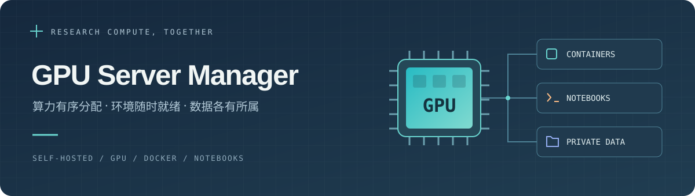

<p align="center">
  
</p>

<h1 align="center">GPU Server Manager</h1>

<p align="center">
  <strong>让团队用好每一张 GPU。</strong><br>
  面向高校课题组与科研团队的自托管 GPU 服务器管理平台。
</p>

<p align="center">
  <a href="https://github.com/huaidan233/GPUServerManager/actions/workflows/ci.yml"></a>
  <a href="https://github.com/huaidan233/GPUServerManager/releases"></a>
  <a href="LICENSE"></a>
  
</p>

<p align="center">
  <a href="docs/deployment-guide.md">部署指南</a> ·
  <a href="docs/user-guide.md">使用手册</a> ·
  <a href="https://github.com/huaidan233/GPUServerManager/releases">下载版本</a> ·
  <a href="CHANGELOG.md">更新日志</a> ·
  <a href="https://github.com/huaidan233/GPUServerManager/issues">反馈问题</a>
</p>

---

从创建开发容器到查看 GPU 曲线，从申请资源到打开 JupyterLab，在一个 Web 控制台中完成。管理员统一管理成员、环境和配额；成员拥有自己的容器、数据目录与连接入口。

## ✨ 功能亮点

| | 能做什么 |
| --- | --- |
| **🧑‍🔬 团队与配额** | 管理员、教师与成员角色；按运行中容器合计 CPU、内存和 GPU 额度，支持两级审批、临时提额、到期提醒和超级用户。 |
| **📦 容器与开发环境** | 创建、启停和调整容器，查看终端与日志；独立 SSH 密码及永久证书，方便接入 VS Code、Xshell 等工具。 |
| **📊 实时监控** | CPU、内存、磁盘和 GPU 使用情况与历史曲线；服务健康、GPU 进程、容器停止原因和诊断信息。 |
| **📓 交互式开发** | 从容器页面打开 JupyterLab、TensorBoard，选择 Python 环境，导出环境说明并复用配置。 |
| **🗂️ 个人数据空间** | 每人独立目录，网页上传、下载、建目录和重命名；可选 SFTP 传输大文件，容器通过 `/workspace` 访问自己的数据。 |
| **🔔 通知与扩展** | GPU 空闲订阅、审批和到期提醒；站内通知，可选 Server酱、微信助手与 Windows 打印接入。 |
| **💾 存储与备份** | 容器环境使用 NVMe/SSD，个人数据与快照归档使用数据盘；容量保护、控制面备份和保留策略。 |
| **⬆️ 在线更新** | 在管理界面检查 GitHub Release，确认后完成校验、构建、备份、数据库迁移和健康检查；失败时自动回退。 |

GPU 空闲提醒采用先启动者先用的方式，不预留或抢占资源。临时额度到期后，已有任务继续运行，新启动操作按回退后的额度检查。

## 🧪 选择适合项目的环境

| 环境 | 适用场景 |
| --- | --- |
| **Python 精简版** | 已有项目、虚拟环境、自行安装 `requirements.txt` |
| **Python 数据分析工作台** | NumPy、pandas、scikit-learn、绘图与 JupyterLab |
| **PyTorch + CUDA** | GPU 训练与推理，预装 PyTorch 的工作台 |
| **CUDA 开发版** | 自选深度学习框架、编译 CUDA 扩展 |
| **Go** | Go 开发、编译与 CGO |
| **Ubuntu** | 通用 Linux 开发环境 |

管理员先构建并加入镜像目录，成员创建容器时选择环境与版本。具体版本、预装依赖和构建方式见[容器环境说明](docs/container-environments.md)。

## 🚀 快速部署

推荐 **Ubuntu Server + Docker Compose**。GPU 主机需要兼容的 NVIDIA 驱动及 NVIDIA Container Toolkit；准备独立数据盘和面板 HTTPS 域名，使用 JupyterLab 时还需独立应用域名。

从 [Releases](https://github.com/huaidan233/GPUServerManager/releases) 下载 `gpu-server-manager-<版本>-source.zip`，解压并进入源码目录：

```bash
# 检查硬件、GPU 与存储
python3 scripts/deploy/initialize_host.py --probe
bash scripts/deploy/check_prereqs.sh

# /data 应已挂载到数据盘；将域名替换为自己的面板地址
sudo env GSM_ALLOWED_ORIGINS=https://gsm.example.edu \
  GSM_DATA_ROOT=/data GSM_SCRATCH_ROOT=/scratch \
  bash scripts/deploy/install_ubuntu.sh
```

安装器会初始化主机清单、构建控制面并引导创建管理员。随后按[部署指南](docs/deployment-guide.md)配置 HTTPS、容器 SSH、应用入口与镜像目录。

> 首次部署请完整阅读部署指南中的磁盘挂载与网络配置。控制面备份不包含个人数据集和模型，个人文件需要单独备份。

## 🧭 日常使用

1. **加入团队**：使用管理员提供的初始密码登录，首次登录设置自己的密码。
2. **准备资源**：查看个人额度，需要更多 CPU、内存或 GPU 时提交用途和使用时间。
3. **创建容器**：选择环境与资源配置，启动后通过 SSH、网页终端或 JupyterLab 开始工作。
4. **保存成果**：将代码、数据集与模型放入 `/workspace`，在个人数据页或通过 SFTP 管理。

详细操作见[用户手册](docs/user-guide.md)。

<a id="本地开发"></a>

## 🛠️ 本地开发

控制面使用 **Python 3.11–3.12**，Web 使用 **Node.js 22+ / npm 10.9.8**。本地默认使用模拟执行能力，可在没有 Docker 或 GPU 的机器上开发 Web/API。

```bash
python -m venv .venv
source .venv/bin/activate
python -m pip install -c requirements/constraints.txt -e ".[dev]"
npm ci

# 终端 1：API
python -m uvicorn gsm_api.main:app --reload --host 127.0.0.1 --port 8000

# 终端 2：Web
GSM_WEB_API_URL=http://127.0.0.1:8000 npm run dev
```

打开 <http://127.0.0.1:3000>。Windows PowerShell 使用 `.\.venv\Scripts\Activate.ps1` 激活环境，并通过 `$env:GSM_WEB_API_URL = "http://127.0.0.1:8000"` 设置 API 地址后运行 `npm run dev`。

<details>
<summary>项目结构与测试命令</summary>

```text
apps/web                 Web 控制台与 BFF
services/api             身份、配额、审批、审计与通知
services/server-agent    Docker、GPU、SSH 与主机采集
services/wechat-agent    微信助手与渠道适配
services/print-agent     Windows 打印代理
services/test-agent      部署验收工具
scripts/deploy           安装器、环境镜像与维护工具
```

```bash
python -m pytest
npm run lint
npm run test:web
npm run build
```

</details>

## 🤝 参与贡献

欢迎通过 [Issues](https://github.com/huaidan233/GPUServerManager/issues) 反馈问题、讨论需求，或提交 Pull Request。开发约定见[贡献指南](CONTRIBUTING.md)，后续方向见[路线图](ROADMAP.md)。安全问题请通过[私密漏洞报告](https://github.com/huaidan233/GPUServerManager/security/advisories/new)提交，详见[安全政策](SECURITY.md)。

## 📄 License

[Apache License 2.0](LICENSE)。
