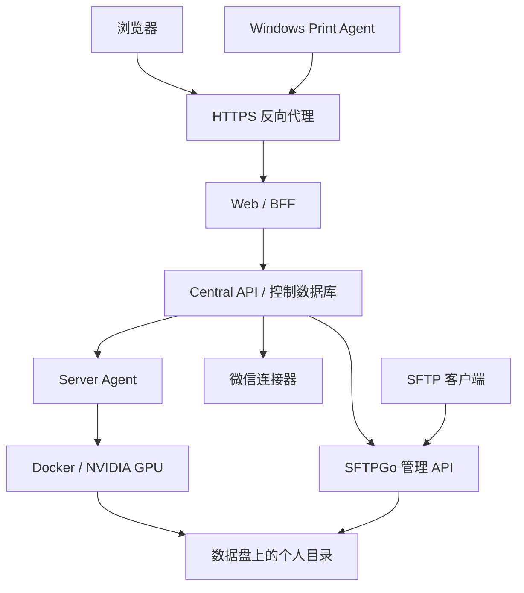

# GPU Server Manager 0.3.0 预发布：部署与功能手册

适用版本：`0.3.0-rc.5`（Python 包版本 `0.3.0rc5`）。本文面向部署管理员；日常操作见[用户手册](user-guide.md)。这是预发布候选版本，建议先在受控环境验收，再交付团队使用。

示例中的 `gsm.example.edu`、`apps.example.edu`、`compute.example.edu` 和尖括号内容均为占位值，必须替换为自己的配置。文档不包含可直接登录的账号或密钥。

## 1. 平台能做什么

| 功能 | 当前行为 |
| --- | --- |
| 成员与身份 | 管理员、教师、普通成员及只读角色；初始密码入组、首次改密、管理员 TOTP、会话撤销；教师不依赖毕业日期 |
| 个人运行配额 | 默认 8 核 CPU、8 GiB 内存、0 张 GPU；统计当前占用资源的容器配置总额，不按瞬时利用率收费或计量 |
| 临时提额 | 全站统一一级管理员、二级教师；由管理员指定；未配置的级别跳过，两级都为空则自动通过；到期回退但不终止运行任务 |
| 超级用户 | 独立的个人配额豁免标记；管理员角色不自动豁免，仍受物理容量、GPU 冲突及存储保护限制 |
| 容器 | 创建、启动、停止、删除、查看日志、网页终端、停止状态改配置；危险操作确认及结果对账 |
| 环境 | Python 精简版、数据分析工作台、PyTorch/CUDA 工作台、纯净 CUDA、Go、Ubuntu；具体可选版本由本机已验证镜像目录决定 |
| SSH | 容器独立密码与短期 SSH 证书；可在校园网直连，网络范围由部署者配置 |
| 应用 | JupyterLab、TensorBoard、Python 环境选择、环境配置导出与复用 |
| 监控 | CPU、内存、磁盘与 GPU 状态和历史；概览中的服务状态、健康事件与诊断 |
| GPU 提醒 | 按卡数、显存和目标服务器订阅空闲提醒；不预留卡、不自动启动、不抢占任务 |
| 个人数据 | 独立成员目录、网页上传/下载/建目录/重命名；可选 SFTP，支持大文件、移动和删除 |
| 通知与微信 | 站内记录、可选 Server酱通知；可选个人微信 iLink 或外部 Webhook 连接器、主备模型配置 |
| 打印 | Windows Print Agent 主动出站连接，发现本机打印机；上传文件、本人确认、队列状态与审计 |
| 恢复 | 加密控制面备份，保留最新 10 份；容器配置快照归档到数据盘，按容器执行 3 份/30 天/至少 1 份保留策略 |
| 在线更新 | 管理员确认安装，预构建、迁移前备份、数据库迁移、健康检查及失败回退；恢复失败时保持维护状态 |

平台不是虚拟机隔离系统，也不是完整的批处理调度器。超级用户不会获得宿主机 root 权限；普通成员的目录隔离依赖容器挂载边界、API 所有权检查和 SFTP 根目录约束。不要给不受信任成员宿主机 Docker socket 或主机 shell。

## 2. 架构与访问边界



Central API 是权限与配额的最终裁决点。Server Agent 持有 Docker socket，属于高权限组件；不能向公网直接开放。微信模型只生成建议和操作意图，不能绕过成员权限、配额和确认步骤。

| 入口 | 默认状态 | 部署要求 |
| --- | --- | --- |
| Web `3000` | 绑定 `127.0.0.1` | 经 HTTPS 代理提供服务 |
| Central API `8000` | 绑定 `127.0.0.1` | 不整体发布到公网 |
| Server Agent / 微信服务 | Compose 内部通信 | 不发布服务端口 |
| 容器 SSH 端口段 | 由部署与容器配置决定 | 显式绑定校园网接口，并限制来源网段 |
| 独立 SFTP `2222` | 可选组件默认绑定本机 | 配置后仅开放给需要的内网范围 |
| Jupyter/TensorBoard | 独立应用来源 | 必须与面板来源不同，仅代理 `/apps/*` |
| Windows 打印 | 主动连接面板 HTTPS | 代理仅额外转发 `/api/print-agent/*` 到 API |

面板、容器 SSH、SFTP 是三个独立入口。开放面板隧道并不会自动开放另外两者。仅内网使用也应使用可信 HTTPS；内部 CA 需要导入用户设备的信任存储。

## 3. 部署前准备

官方安装脚本面向 Ubuntu Server 和 Docker Compose。平台服务支持 Python 3.11–3.12；当前 `crypt` 依赖尚不适配 Python 3.13。Web 开发/构建要求 Node.js 22+ 和仓库声明的 npm 版本。开发环境可在 Windows/Linux/macOS 上使用 mock Agent；完整文件管理和 GPU 实机能力以 Linux 主机为目标。用户容器中的项目 Python 可以不同，以已发布镜像为准。

准备以下内容：

1. 可 `sudo` 的维护账号、可靠的磁盘挂载、服务器时间同步和维护窗口。
2. NVIDIA GPU 主机先安装兼容驱动，确认 `nvidia-smi` 正常；容器 GPU 还需要 NVIDIA Container Toolkit。不要把容器 CUDA 版本当成宿主驱动版本。
3. 软件源、镜像仓库和所需通知/模型服务的网络访问。校园网认证需由本单位完成；仓库不预置常驻代理或私人网络凭据。
4. 面板域名和可信证书；需要 Notebook 时再准备独立应用域名。DNS、证书申请、隧道和校园网防火墙不由通用安装器自动完成。
5. 独立保存密钥和备份的介质或位置。磁盘上的本地备份无法抵御同盘损坏。

先执行只读检查：

```bash
python3 scripts/deploy/initialize_host.py --probe
bash scripts/deploy/check_prereqs.sh
nvidia-smi
lsblk -o NAME,SIZE,TYPE,FSTYPE,MOUNTPOINTS,ROTA
findmnt -T /var/lib/docker
findmnt -T /var/lib/containerd
findmnt -M /data
```

`--probe` 只输出探测结果。实际安装会记录 CPU、内存、GPU、磁盘和系统预留到 `/etc/gpu-server-manager/inventory/server.json`。已有清单不会因再次安装而静默覆盖；硬件不一致时需要先核实。

### 推荐存储布局

| 内容 | 推荐介质 | 说明 |
| --- | --- | --- |
| 操作系统、Docker/containerd 镜像和容器可写层 | NVMe/SSD | 保留环境启动、包安装和小文件读写性能 |
| `/data/users/<member>` → 容器 `/workspace` | 大容量数据盘 | 同一成员的容器共用自己的目录，其他成员不可选择挂载 |
| `/data/snapshots` | 数据盘 | root 私有的容器配置快照归档 |
| `/scratch/users/<member>` | 按项目需求选择 | 单独核实实际设备；目录名本身不代表它在另一块盘 |
| 控制面状态和本地备份 | 默认系统盘 | 体积通常较小；再复制验证过的备份到独立故障域 |

必须先将数据盘按 UUID 持久挂载到 `/data`，再创建用户目录。不要仅创建名为 `/data` 的普通目录后就认为完成了分盘。安装器不会自动格式化磁盘或迁移已有用户数据。

同一镜像的只读层通常由多个容器共享。20 个容器不会必然占 20 份基础镜像，但各自安装的包、缓存、日志和可写层会继续增长。只有写入数据盘挂载目录的文件才进入数据盘；停止容器不会释放其磁盘内容。

## 4. 安装控制面

取得本版本源码，在仓库根目录执行：

```bash
sudo env GSM_ALLOWED_ORIGINS=https://gsm.example.edu \
  GSM_DATA_ROOT=/data GSM_SCRATCH_ROOT=/scratch \
  bash scripts/deploy/install_ubuntu.sh
```

`GSM_ALLOWED_ORIGINS` 必须是浏览器实际访问的完整 HTTPS 来源，包括非默认端口（如果有），不允许路径或通配符。镜像源可以用安装脚本支持的 `GSM_DOCKER_REGISTRY_MIRRORS` 自行选择；不要把含认证信息的源地址提交到仓库。

安装过程涉及系统软件、Docker/Toolkit 配置、镜像构建、硬件与存储初始化、初始管理员和验收，不是只复制文件。数据盘必须与系统及 Docker 运行时设备分离；缺少独立挂载时安装会拒绝回落系统盘。首次管理员通过交互式 `gsm-member-admin bootstrap-admin` 建立；保存 TOTP 注册信息及恢复码。

普通安装与测试实例的 `start` 始终执行基础 Web/API/Agent smoke。完整 Web/微信成员身份联调默认明确输出 `SKIPPED`，不要求新安装已配对微信。启用微信并配对测试成员后，单独执行：

```bash
# 正式目录的部署
sudo bash scripts/deploy/install_ubuntu.sh identity-smoke
# 隔离测试目录的部署
sudo bash scripts/deploy/install_test_ubuntu.sh identity-smoke
```

如果要将该联调作为安装或测试 `start` 的强制门禁，在原命令的 `sudo env` 中额外设置 `GSM_RUN_MEMBER_IDENTITY_SMOKE=1`；失败会使流程失败。成员用户名、密码、适用时的 TOTP 和已配对路由通过交互输入或临时 `GSM_SMOKE_MEMBER_*` 变量提供，不写入配置文件。`SKIPPED` 不等于通过，也不能用基础健康检查代替已启用微信的实际身份与送达验收。

安装后的主要位置：

| 位置 | 内容 |
| --- | --- |
| `/opt/gpu-server-manager/source` | 部署源码 |
| `/opt/gpu-server-manager/docker-compose.yml` | 服务定义 |
| `/etc/gpu-server-manager/gsm.env` | root 私有的部署配置来源 |
| `/etc/gpu-server-manager/{api,web,server-agent,wechat-agent,test-agent}.env` | 各服务配置 |
| `/etc/gpu-server-manager/agent-settings.env` | 模型配置加密密钥及可选首次引导值 |
| `/etc/gpu-server-manager/storage.env` | 已核验的个人盘、快照与运行盘路径和设备号 |
| `/etc/gpu-server-manager/ssh` | 成员 SSH CA，私钥不得下发给成员 |
| `/var/lib/gpu-server-manager` | 控制数据库、Agent 状态、操作回执及备份 |

不要将完整 `gsm.env` 随意挂载到其他容器。配置文件为敏感文件，发布包、Issue、截图和日志中均不应包含它们。

```bash
sudo systemctl status gsm.service
sudo docker compose -f /opt/gpu-server-manager/docker-compose.yml \
  --env-file /etc/gpu-server-manager/gsm.env ps
curl --fail http://127.0.0.1:8000/api/health
```

### GPU Xid 日志采集

标准 Server Agent 镜像提供 `journalctl`。安装器检查已有的 `/var/log/journal` 和 `/run/log/journal`，将选中的父目录写入 root 部署配置 `GSM_HOST_JOURNAL_PARENT`；Compose 将该目录只读挂载到 Agent 的 `/host/log`。未找到 journal 时默认使用 `/var/log`，不会创建宿主 journal 目录或改变 journald 的持久化策略。自定义部署需核对该只读挂载及 `/proc` → `/host/proc` 挂载，不能用容器自身的日志替代宿主日志。

采集器先确认当前宿主启动周期的内核日志可读，再检查最近 10 分钟的 NVIDIA Xid。缺少工具、日志或权限，以及查询失败时，健康状态显示 `collector_unavailable` / `degraded`；这表示无法判断该项，不等于“没有 Xid”，也不直接说明 GPU 硬件损坏。应先恢复日志采集，再结合 GPU 状态和实际错误分析。没有近期 Xid 也不能代替完整硬件诊断。

仅需隔离试用时可使用 `install_test_ubuntu.sh prepare`、`bootstrap`、`start`，但测试与正式服务仍共享物理 GPU、CPU 和磁盘。两个独立控制面不能同时为同一批 GPU 分配资源。

## 5. 配置 HTTPS 与应用入口

反向代理应覆盖传入的来源头，不接受客户端自行声明的内部认证头。下面是运行在宿主机上的 Caddy 配置结构；`GSM_EDGE_PROXY_SECRET` 应由受保护的服务环境注入，不能填写进公开配置样例：

```caddyfile
gsm.example.edu {
    handle /api/print-agent/* {
        reverse_proxy 127.0.0.1:8000
    }
    handle {
        reverse_proxy 127.0.0.1:3000 {
            header_up X-GSM-Edge-Client-Source {remote_host}
            header_up X-GSM-Edge-Secret {$GSM_EDGE_PROXY_SECRET}
            header_up X-Forwarded-Proto https
            header_up -X-GSM-Client-Source
            header_up -X-GSM-Client-Timestamp
            header_up -X-GSM-Client-Signature
        }
    }
}

apps.example.edu {
    handle /apps/* {
        reverse_proxy 127.0.0.1:8000
    }
    handle {
        respond "Application access only" 403
    }
}
```

Caddy 获取证书仍取决于 DNS 和可用的 ACME 验证方式；示例不会自动处理无公网入站环境。使用其他代理时保持相同路由和头部策略。打印功能未启用时可以省略打印专用路由。

在 API 配置 `GSM_APP_PUBLIC_ORIGIN=https://apps.example.edu`；不要把应用来源加入面板的 `GSM_ALLOWED_ORIGINS`。Agent 的 `GSM_APP_NETWORK_POOL` 必须避开校园网、宿主路由和已有 Docker 子网，例如在核实无冲突后使用 `172.30.0.0/16`。

应用通过短时一次性票据和独立网关访问，不能把用户容器的 Jupyter 端口直接公开。需要支持 WebSocket，否则 Notebook 可能能打开但内核连接失败。

### 校园网 SSH

API 配置 `GSM_PUBLIC_SSH_HOST=compute.example.edu`，Agent 配置 `GSM_AGENT_SSH_BIND_ADDRESS=<校园网 IPv4>`；同时在部署配置来源保留对应值。默认容器 SSH 端口范围是 `22001–22999`，可用 `GSM_SSH_PORT_START`/`GSM_SSH_PORT_END` 调整。

修改显示地址并不改变现有容器的监听地址。已有容器需在停止状态保存涉及绑定的配置后再启动。实际防火墙应覆盖 Docker 转发路径及 IPv6；仅修改 UFW 普通入站规则可能不足。不要把未经核实的实验室网段规则直接复制到其他学校。

## 6. 个人数据、SFTP 与快照归档

标准 0.3 安装器会在 Docker 就绪后初始化这些路径、设备号与保护配置；已有安装升级仍须检查自己的布局。SFTP 是额外可选组件。未配置或校验不通过时，不能通过关闭检查让数据落回系统盘。

### 6.1 个人目录与数据盘保护

标准安装前可只读检查：

```bash
findmnt -M /data
sudo python3 scripts/deploy/initialize_storage.py \
  --data-root /data --scratch-root /scratch --check
```

`--check` 只验证与显示计划，不创建目录。正式安装自动调用该工具，验证数据盘为独立块设备，创建 root 拥有的 `users` 目录（0751）、私有 `snapshots` 目录（0700）以及 `.gsm-data-volume` 标记；成员叶目录按镜像 UID/GID 后续创建。结果写入 `storage.env`，并同步到部署/API/Agent 配置，包括：

```dotenv
GSM_PERSONAL_DATA_ROOT=/data/users
GSM_PERSONAL_DATA_DEVICE=<实际 major:minor>
GSM_DATA_UID=10000
GSM_DATA_GID=10000
```

API 的 `GSM_DATA_ROOT` 与 Compose 的同名值必须一致，默认 `/data`；改变目录时同步更新 Agent 挂载和允许根目录。默认托管镜像用户 UID/GID 为 `10000:10000`。自定义镜像必须按实际身份匹配，不能对整块已有数据盘递归改属主。

既有手工部署先做只读检查，再由维护人员审查合并配置和挂载，不要直接在未核实的磁盘上重复初始化。工具不会格式化磁盘、搬迁 Docker 或复制已有个人文件。根目录必须是无符号链接的规范绝对路径。

API 和 Agent 会按当前账号选择目录，网页请求不能指定另一个成员。网页不跟随符号链接、不覆盖同名重命名目标。SFTP 可进行显式覆盖和删除，使用时仍需注意项目文件。

### 6.2 启用独立 SFTP

仓库提供 [SFTP Compose 扩展](../scripts/deploy/docker-compose.sftp.yml)。它需要额外部署 SFTPGo，而不是启动主控制面就自动可用：

1. 在数据盘创建 `/data/sftpgo`，授予扩展文件中服务身份 `10000:10000` 写入权限；用户目录与网页功能共用 `/data/users`。
2. 通过受限的管理通道初始化 SFTPGo，建立用于管理用户的 API Key，并写入 root 私有配置。不要公开其管理界面或 API 端口。
3. 创建 `/etc/gpu-server-manager/sftpgo.env`，配置 SFTPGo 的内部 HTTP API 监听和持久状态；具体选项以选定 SFTPGo 版本为准。扩展只向外发布 SFTP，不发布 HTTP 管理端口。
4. 在 API 私有环境设置 `GSM_SFTPGO_URL=http://sftpgo:8080`（须与实际内部监听一致）、`GSM_SFTPGO_API_KEY`、`GSM_SFTPGO_USERS_ROOT=/srv/gsm-users`、`GSM_PUBLIC_SSH_HOST=compute.example.edu`、`GSM_DATA_SFTP_PORT=2222`。
5. Compose 插值配置中设置 `GSM_DATA_SFTP_BIND_ADDRESS=<校园网 IPv4>`，按校园网范围配置防火墙。默认绑定 `127.0.0.1` 无法供其他电脑直连。
6. 将扩展加入固定的 Compose 启停配置，启动后由普通成员在「我的数据」设置 SFTP 密码或公钥，验证只能看见自己的根目录。

SFTP 用户名由平台生成，不等于网页用户名，也不等于容器的 `researcher`。每个账号最多同时建立 5 个 SFTP 会话。后台周期同步成员状态：有效成员可读写，待离组成员只保留列目录/下载，禁用或归档成员不可访问；权限变化会断开旧连接，成员恢复有效后重新启用。该同步依赖后台正常运行，不是修改成员状态瞬间完成。

### 6.3 快照归档与保留

标准 Compose 已挂载快照目录，安装器设置 `GSM_SNAPSHOT_ROOT=/data/snapshots`；新安装不需要再次加入快照扩展。旧自定义 Compose 可参考 [快照扩展](../scripts/deploy/docker-compose.snapshots.yml) 补齐相同挂载，先核实数据盘与权限。后台按小时维护，Agent 启动后也会开始检查。

快照用于停止容器改 GPU/SSH 绑定等需要重建的配置操作，不是定时备份全部训练数据。归档策略为：

- 每个逻辑容器保留最近 3 份中未超过 30 天的快照，始终保留最新 1 份。
- 所有被容器引用的镜像，包括停止容器，以及未完成配置/恢复事务所需镜像，均受保护。
- 无法确定归属的旧记录、Docker 拒绝删除的依赖镜像保守保留，因此实际可能超过 3 份。
- 归档保留至少 20 GiB 可用空间，记录 SHA-256；恢复导入前校验哈希。

数据盘归档不会立即搬走 Docker/containerd 中的活动镜像层。过期且无依赖的快照才尝试非强制删除；不要用无差别 `docker system prune -a` 代替该策略。

目前归档恢复是管理员维护工具，入口为 `gsm_server_agent.snapshot_storage.restore_image(runtime, image_id)`；它导入并校验镜像，不自动替换或启动用户容器。用户界面的恢复/对账用于处理容器操作状态，不等同于完整文件恢复向导。

### 6.4 持久化扩展配置

临时运行一次 `docker compose -f ... -f ... up` 不足以保留可选 SFTP 或其他自定义扩展：systemd 后续启停也必须使用相同的文件组合。扩展应保存在独立文件中，并在[注册升级器](#在线升级与自动回退)时逐个传入 `--compose-file`，由安装器持久记录。不要直接改基础 Compose；自动升级会拒绝已被定制的基础文件。标准版快照挂载已在主 Compose 中，不需要重复添加。

额外环境参数建议保存在自己的部署扩展中；重新运行旧安装器会重建部分按服务拆分的环境文件。更新之前保存这些扩展，更新之后用 `docker compose config` 核对实际值和挂载。其输出可能包含密钥，只在维护终端查看，不上传到 Issue。

## 7. NVMe 容量管理

标准安装器读取 Docker 实际数据根目录，作为只读 bind mount 映射到 Agent 的 `/host/runtime-storage`，并记录设备号；Compose 不会在主机路径缺失时自动建一个替代目录。主要配置为：

```dotenv
GSM_RUNTIME_HOST_ROOT=<Docker 实际数据根目录>
GSM_RUNTIME_STORAGE_PATH=/host/runtime-storage
GSM_RUNTIME_STORAGE_DEVICE=<实际 major:minor>
```

安装器还会检查 `/var/lib/containerd`（存在时）与 Docker 数据根目录的设备号；两者分属不同设备会拒绝初始化，因为当前单一容量守卫不能代表两块独立磁盘。采用非标准 containerd 数据目录的管理员仍需自行核对实际位置，不能只依赖默认路径检查。

| 条件，任一满足即生效 | 行为 |
| --- | --- |
| 已用达到 80%；可用少于 100 GiB；空闲 inode 少于 10% | 概览 → 服务状态产生预警 |
| 已用达到 90%；可用少于 50 GiB；空闲 inode 少于 5% | 阻止新建容器、镜像下载和快照生成 |
| 路径或设备不匹配、不能确认容量 | 上述增长操作失败关闭，要求维护 |

标准安装会启用该保护；自定义部署若未设置 `GSM_RUNTIME_STORAGE_PATH` 则不会自动启用。它不是每容器可写层限额，也不会中断已有容器的写入；仍需监控增长、约束日志、让用户把数据集/权重/缓存放到 `/workspace`。不要承诺它能彻底防止写满。

## 8. 发布基础镜像

镜像只有同时满足「实际存在、固定 ID 与目录一致、Agent 信任、通过验证」才能开放创建。管理员在网页修改推荐或暂停新建，并不会自动下载、构建或扫描镜像。

| 镜像类别 | 适用场景 | 注意点 |
| --- | --- | --- |
| Python 精简版 | 自带项目依赖、希望自行管理虚拟环境 | 只提供 Python/pip/venv 等基础工具 |
| Python 数据分析工作台 | sklearn、NumPy、pandas、绘图、Notebook | 不默认包含 PyTorch |
| PyTorch CUDA 工作台 | GPU 训练与推理 | 当前构建配方为 Python 3.11 / PyTorch 2.11.0 / CUDA 12.8 runtime；不含 nvcc |
| 纯净 CUDA 开发版 | 自行安装框架、编译 CUDA 扩展 | 有编译器和头文件；不等于有 PyTorch |
| Go / Ubuntu | 编译开发或通用 Linux 项目 | 第三方模块仍需软件源或项目 vendor |

构建说明位于 [Python 版本镜像](../scripts/deploy/docker/python-variants/README.md)与 [PyTorch CUDA 工作台](../scripts/deploy/docker/pytorch-workbench/README.md)。Python 配方提供不同小版本的精简版和工作台，实际可选版本以部署后目录为准，不能承诺任意版本自动生成。

发布流程：

1. 审查基础镜像、固定版本、解释器校验值和依赖锁文件；准备匹配平台的 wheelhouse。
2. 本机构建并执行普通用户运行测试，检查 `pip check`、科学计算样例、SSH、Jupyter；GPU 镜像额外执行真实 CUDA 运算。
3. 导出目录记录，保留不可变镜像 ID、运行版本、驱动要求和准确的安全检查范围。
4. 将新 ID 加到 Agent 的 `GSM_AGENT_TRUSTED_SSH_IMAGE_IDS`；保留旧容器仍使用的 ID。
5. 合并 API 镜像目录 `/etc/gpu-server-manager/inventory/environments.json`（或 `GSM_ENVIRONMENT_CATALOG_PATH` 指定文件）后重载相关服务，在「系统 → 镜像与环境」设置可新建/推荐策略。

`prepare_environment_catalog.py` 会检查脚本指定的本地镜像，不会自动补齐缺失镜像；其历史固定清单不能当成任意环境的一键构建器。新增目录应合并而非覆盖现有自定义记录和管理员策略。

首次点击 Jupyter 可以在容器独立环境准备缺失依赖，不升级原项目的 torch。无外网环境需由管理员提供匹配 Python/平台的 `jupyter-wheels.tar` 到 Agent 设置状态目录；安装器不会自动下载所有 Python 版本的离线包。TensorBoard 需预先安装。

## 9. 个人配额与审批配置

在「系统 → 配额与审批」设置全站基础额度和统一审批人。默认 8C/8 GiB/0 GPU，一级必须是有效管理员，二级必须是有效教师；普通用户不能自行挑选审批人。

临时额度填写的是**使用期间的总上限**，不是额外增加量。多份重叠批准按各维度较高上限生效，不累加。开始时间到达后生效，最长单次 366 天；临近到期和到期时生成提醒。

启动时按个人所有运行容器的配置求和；为防止并发绕过，启动中、停止中、状态未知等尚未确认释放的资源也保守计入。停止状态可以保存超出个人额度的配置，但单个容器不可超过服务器可分配容量，启动时仍需满足个人额度。

到期后已有任务继续运行，新启动按回退后的额度检查。不配置审批人会跳过审批，不是拒绝申请；上线前应明确是否接受自动通过。指定审批人可以审批自己的申请，这是当前规则。

「系统 → 超级用户」仅豁免个人配额，不改变角色。**管理员和教师角色都不自动免除个人配额**：需要不受个人额度限制地使用资源时，由管理员在此入口搜索相应成员并勾选超级用户。普通管理员未勾选时仍按基础额度和有效临时额度检查，例如默认 GPU 额度为 0 时不能直接启动 GPU 容器。

超级用户仍受单容器物理上限和存储保护限制。GPU 仍按整卡冲突检查，不会因低利用率自动抢占。基础配额之和可以大于物理总量，但这不代表每个容器能超过单机容量或无限并发运行。

## 10. 通知、微信与打印

### GPU 与额度通知

用户在「我的账户 → 通知与微信提醒」配置自己的 Server酱 SendKey、启用状态和每日发送上限。密钥经服务端加密保存，页面仅回显指纹。站内通知不依赖外部渠道；Server酱套餐限额以其服务规则为准，本地限额不会提高外部额度。

GPU 订阅默认 24 小时有效，匹配后提醒一次，可以续订。提醒不锁定 GPU，真正启动时重新检查空闲和个人 GPU 额度。

### 微信 Agent

原生个人微信 iLink 由管理员部署连接器并扫码登录；成员在网页生成一次性配对码，在机器人会话发送 `/pair <配对码>`。连接器需要服务器能出站访问对应服务，不需要公开回调；普通 Webhook 模式则需要额外的桥接服务。

```bash
sudo bash scripts/deploy/setup_wechat_ilink.sh
```

先阅读该脚本的参数和交互提示，选择与当前部署一致的目录/模式。不要同时运行多个接收实例。微信公众号、企业微信不是填写 App ID 后即自动支持的功能。

在「系统 → 微信 Agent」配置主、备模型地址、模型名与密钥，并分别测试；高权限配置要求近期管理员验证。模型不可用时，受支持的确定性操作与模型问答的可用范围不同；不能把任何自然语言都视为可以执行。

个人微信渠道的主动发送受平台有效会话上下文等规则限制，沉默较久后可能需用户先发一条消息；它不保证永久主动推送。长期提醒可采用站内记录和单独配置的 Server酱通道。

### Windows 打印电脑

1. 在 Windows 上安装打印机驱动，先确保本机能够正常打印；安装 Python 3.11–3.12 与兼容 PDF 渲染器。
2. 在「系统 → 打印机接入」添加打印电脑，下载部署包，取得一次性显示的安装命令。
3. 以管理员身份执行安装脚本，使用网页提供的 Agent ID/token 和本机真实渲染器路径。
4. 刷新页面，检查心跳和打印机发现；先完成不耗纸 dry-run，再人工批准打印一张无敏感内容的测试页。

```powershell
.\scripts\deploy\install_print_agent_windows.ps1 `
  -CentralUrl "https://gsm.example.edu" `
  -AgentId "print-pc-01" `
  -AgentToken "<本次签发的 token>" `
  -RendererPath "C:\Program Files\SumatraPDF\SumatraPDF.exe"
```

Print Agent 主动出站连接，不需开放 Windows 入站端口；代理必须支持前述打印专用路径。更新凭据后同步更新打印电脑配置。打印任务不会自动停止 GPU 容器。

## 11. 备份、恢复与升级

### 控制面备份

控制数据库和明确允许的配置密钥被加密打包；不包括个人文件、模型、镜像、卷、快照归档、原始遥测、年度分析或打印文件。需另行为个人数据和 Agent 操作状态制定备份方案。

```bash
sudo bash scripts/deploy/backup_sqlite.sh
```

网页也可在「系统 → 控制面备份」创建、校验并查看备份。通过控制面备份服务创建的手工、自动、升级前和恢复前备份共用最新 **10 份**保留规则；活动恢复引用和无法安全识别的异常文件会暂时保留。下述宿主升级器的事务快照独立保存，不属于这 10 份加密备份。旧版本的每日/每周保留参数不再代表本版规则。

恢复先在页面发起并精确确认，取得恢复票据，再安排停机，执行页面生成的命令：

```bash
sudo bash scripts/deploy/restore_sqlite.sh <backup-key> <restore-ticket>
```

脚本停止控制面、恢复后重启；不能在线替换正在使用的数据库。备份加密密钥、模型设置加密密钥和 SSH CA 必须妥善保存。恢复验证应包含管理员登录、模型指纹、成员权限、容器记录和个人数据挂载，不只看进程是否启动。

### 在线升级与自动回退

`0.3.0-rc.5` 支持管理员在线安装更新。GitHub Release 提供发布资产，真正执行升级的是主机上的独立 root 服务。它在 API/Web 重启期间继续运行，网页可以恢复后继续查询同一操作。不会在无人确认时自动安装新版本。

新安装器会注册升级服务。已有部署先保存原配置，把对基础 Compose 的定制拆成持久扩展文件，再执行：

```bash
sudo python3 scripts/deploy/upgrade_manager.py install \
  --app-root /opt/gpu-server-manager \
  --config-dir /etc/gpu-server-manager \
  --state-dir /var/lib/gpu-server-manager \
  --compose-file /opt/gpu-server-manager/docker-compose.yml \
  --management-unit gsm.service
```

有 SFTP、快照或本地扩展时，为每个扩展追加 `--compose-file /绝对路径/扩展.yml`。保留基础 Compose 为当前运行源码中的发行版原文件；更新器发现基础文件被直接定制会拒绝安装，避免覆盖定制。扩展中的相对路径仍以原基础 Compose 所在目录为准。沿用旧部署时必须保留 Compose project、`GSM_DEPLOYMENT_ID`、数据库/数据路径和入口端口，否则已有研究容器可能无法被识别。

安装器将可信配置写入 `<app-root>/updater.json`，服务名为 `gsm-upgrade-manager@<compose-project>.service`。应用目录及其祖先必须由 root 控制，不允许其他用户写入。root 执行器通过 `<app-root>/updates-public/manager.sock` 接收固定操作；维护标记也位于该目录。安装器生成永久扩展 `docker-compose.updater.json`，将整个目录以只读方式挂入 API 的 `/run/gpu-server-manager-updater`。API 可连接指定 socket，但不能替换目录、修改维护标记或提交任意宿主命令。

已有部署注册完成后，需要在维护窗口通过原管理服务启动或重启控制面，例如 `sudo systemctl restart gsm.service`，让 API 加载新的只读挂载；仅注册升级器不会重建正在运行的 API。测试部署应使用对应的目录和 `gsm-test.service`。后续保留 `updater.json`、永久扩展及 systemd drop-in，通过管理服务启停，避免直接使用缺少扩展的 `docker compose up`。

管理服务启动先等待升级器完成启动恢复，再通过 `start-control-plane` 在部署锁内检查状态和启动服务；升级、恢复与启动共用这把锁。未连接升级器、仍有维护标记或状态为 `recovery_required` 时拒绝启动。不要删除 drop-in 或手工删除维护标记绕过这个检查。

常规管理员只需使用网页。启用官方预发布更新时，同步修改 `gsm.env` 和 `api.env`：

```dotenv
GSM_UPDATE_REPOSITORY=huaidan233/GPUServerManager
GSM_UPDATE_CHANNEL=prerelease
```

然后重新运行上面的 `install` 命令刷新 root 可信仓库配置，在维护窗口通过管理服务重建 API，使检查配置生效。默认仓库空值禁用远程检查。需要自己的发布源时，替换为包含完整发布附件的公开仓库。候选版使用 `prerelease`；只接收正式版时使用 `stable`，尚无正式版时该通道显示暂无版本。版本检查有 5 分钟缓存，任务状态每 5 秒刷新，网络失败会明确显示失败。

在「系统 → 版本与更新」依次检查版本、准备安装包、确认安装。准备只下载并校验发布包，准备记录有效期为 **1 小时**。准备/安装/手动回退均要求动态验证码，安装还需输入 `UPGRADE <目标版本>`。每组验证码只能用于一次升级操作，准备后需等下一组验证码再安装。

确认安装后先构建新镜像，构建失败不会中断运行服务。进入维护后暂停 API 新请求与后台任务，排空已有操作，再停止控制面。**配置、SQLite 和 Agent 状态的事务快照必须保存、校验并落盘完成，才会启动数据库迁移**。迁移在指定名称的一次性 API 容器中运行；恢复时会确认包括该容器在内的数据库写入者全部停止。健康检查核验 API/Agent、Web 与实际镜像版本，全部通过才切换持久版本配置并退出维护。旧版 API 没有排空接口时，仍要求确认控制面已优雅停止后才创建快照。

自动升级只支持标准持久化布局。执行器检查旧版和候选版渲染后的环境与挂载：三个 API 数据库必须位于容器内 `/var/lib/gpu-server-manager/`，并实际绑定到本部署的 state 目录；Agent 回执和设置位于其 `server-agent` 子目录。外置数据库、命名卷、符号链接或遮蔽这些路径的额外挂载会被拒绝，不会在未覆盖备份的数据库上尝试迁移。

迁移或启动失败时，执行器尝试恢复升级前的配置、SQLite 快照、原镜像和源码路径。跨多个 SQLite 文件的迁移通过恢复整个一致的备份回退。已完成的版本可在页面手动回退，但这会丢弃升级后新增的控制面记录，因此需要勾选数据回退确认，并输入 `ROLLBACK <恢复点ID>`。研究容器和个人数据不随控制面回退，执行前应安排维护并核对期间产生的资源变化。

升级器不停止 Docker，不停止用户研究容器，不升级 CUDA 驱动、研究镜像、SFTPGo 或外部代理。数据库迁移覆盖控制面/身份、GPU 和资源历史、分析库；Agent 操作回执也纳入事务备份。个人文件、容器可写层、打印文件等仍需独立备份。升级事务材料位于 `<app-root>/updates-private`，只允许 root 访问，其中配置和数据库快照不是网页备份服务生成的加密归档。它们与网页保留最新 10 份的备份分开，**目前没有自动保留数量或过期清理策略**；预留空间并由维护人员核对活动恢复点后管理，不要在事务执行中清理。

断电或进程中断后，升级服务依据持久事务尝试恢复；若恢复检查失败，会保持维护状态并显示需要人工恢复，不假装升级成功。排查时使用：

```bash
sudo python3 /usr/local/lib/gpu-server-manager/upgrade_manager.py \
  --config /opt/gpu-server-manager/updater.json status
sudo journalctl -u gsm-upgrade-manager@<compose-project>.service -n 100 --no-pager
```

真实服务名请替换占位值。受限诊断日志位于 `<app-root>/updates-private/diagnostics`，只保留最近 20 份；其中可能含外部命令输出或配置，不能原样发布到 Issue。恢复时先确认备份完整、磁盘空间和数据库目录权限，确认没有执行中的升级后，先停止该升级服务，再使用同一 CLI 的 `recover`，最后重新启动升级服务；也可重启升级服务触发自动恢复。运行中的服务持有独占锁，CLI 不会并行强制恢复。恢复失败保持维护状态，需要检查并修复原因。

### 未公开仓库时的本地发布包

每个 Release 必须有 `gpu-server-manager-0.3.0-rc.5-source.zip`（版本随发布变化）、`release-manifest.json` 和 `SHA256SUMS`。只有 GitHub 自动生成的 Source code 压缩包不能自动安装。清单包含大小、SHA-256、安装模式和更新协议；校验和保证一致性，发布来源仍依赖可信仓库及其发布权限。

本地包由 root 显式暂存，之后沿用相同升级事务，不必先将项目发布到 GitHub：

```bash
sudo python3 /usr/local/lib/gpu-server-manager/upgrade_manager.py \
  --config /opt/gpu-server-manager/updater.json stage-local \
  --archive /root/release/gpu-server-manager-0.3.0-rc.5-source.zip \
  --manifest /root/release/release-manifest.json
sudo python3 /usr/local/lib/gpu-server-manager/upgrade_manager.py \
  --config /opt/gpu-server-manager/updater.json apply --prepared-id <上一步返回的ID>
```

本地暂存是 root 对发布来源的明确确认，可在未配置远程仓库时使用；它不代表 GitHub 在线更新链路已验收。发布包按版本缓存：同一版本、同一 SHA-256 复用已有包并生成新的准备记录；同一版本换了内容会被拒绝。修改源码重新发布时必须使用新的版本号，不能覆盖已缓存或正在使用的版本，也不要为了重用版本号删除活动事务材料。下载缓存的完整性还会在实际解包时校验。

CLI 返回接收结果不等于已完成；继续查询 `status`，同时查看 `operation.action`：`prepare` 的 `succeeded` 仅表示准备完成，只有 `apply` 的 `succeeded` 才表示安装完成；`rolled_back` 表示已恢复旧版，`recovery_required` 表示需要人工处理。网络中断后先查询同一操作，不要盲目重复提交。原 `gsm-update check/stage` 仍只负责检查/下载，不会安装。

本设计参考 [sub2api 的更新实现](https://github.com/Wei-Shaw/sub2api/tree/9591136d45cef26453348ed9532a7ebbce7cf99c)，并为本项目的多服务镜像、SQLite 和 Agent 状态增加了停写、离线迁移和整套恢复流程。后续更新协议变化可能要求维护人员先更新宿主执行器，旧执行器会拒绝不支持的协议。


## 12. 交付验收清单

以下检查需要自己的实际主机与账号；源码测试通过不能替代它们。

- HTTPS、TOTP、首次改密、会话撤销正常；没有直接公开 API/Agent。
- 两个普通账号互相看不到对方文件；网页与 SFTP 上传的文件能从本人的 `/workspace` 读取。
- 数据盘未挂载或设备不匹配时拒绝写入，重启后挂载和标记仍生效。
- 普通用户默认 8C/8 GiB/0 GPU；并发启动不能越过个人额度；两级审批、跳过、拒绝、到期回退均符合组织设置。
- 容器 SSH、网页终端、停止后改配置、重启后数据保留符合预期；单容器不能超过宿主可分配容量。
- Python 科学计算样例和 GPU 实际运算通过；Jupyter 内核与所选 Python 一致；应用来源隔离有效。
- GPU 历史与主机实际负载变化一致；无法取样时显示不可用而非假装为零。
- 磁盘保护读取真实运行时设备；快照归档位于数据盘；保护中的镜像未被误删。
- 备份创建/校验/保留和一次独立恢复演练完成；回滚材料可用。
- 已启用的微信、Server酱与打印分别进行实际端到端验收，避免只验证页面开关。

发现问题时，提供版本、时间、操作步骤和脱敏日志。不要上传完整环境文件、数据库、用户目录、私人密钥或包含会话令牌的浏览器网络导出。
